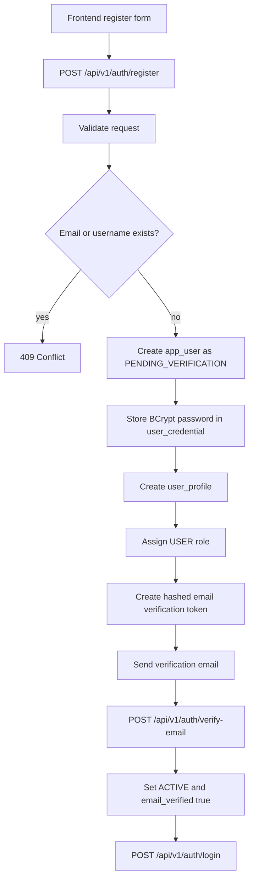
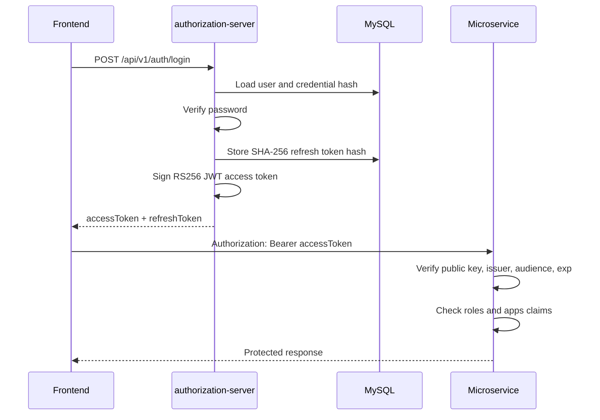

# Authorization Server

Secure Spring Boot identity and user-management service for REST APIs and microservices.

## Current Stack

- Java 21
- Spring Boot 4.0.6
- Spring Security
- Spring Data JPA
- MySQL 8
- Flyway migrations
- Jakarta Validation
- Lombok
- JJWT with RS256 public/private key signing
- Springdoc OpenAPI / Swagger UI
- Spring Mail SMTP integration
- JUnit 5 and Mockito tests

## Implemented Features

- User registration and email verification
- Login with short-lived JWT access tokens
- Opaque refresh tokens with rotation
- Logout and logout from all devices
- Forgot/reset password
- Current-user profile, password, and session APIs
- Admin user, status, role, application-access, and audit-log APIs
- `SUPER_ADMIN` access for all apps
- `ADMIN` access for assigned apps only
- Transactional outbound email through SMTP2GO-compatible SMTP
- MySQL schema managed by Flyway
- Hibernate `ddl-auto=validate`

## Local Requirements

- Java 21
- Maven 3.9+
- MySQL 8
- Docker, if using the provided MySQL container

## Local Database Options

The current `application-local.yml` points to local MySQL:

```text
Host: localhost
Port: 3306
Database: auth
Username: root
Password: root
```

If you want to use the Docker MySQL from `docker-compose.yml`, start it:

```powershell
docker compose up -d
```

Then run with these environment variables:

```powershell
$env:DB_HOST="localhost"
$env:DB_PORT="3307"
$env:DB_NAME="authorization_server"
$env:DB_USERNAME="auth_user"
$env:DB_PASSWORD="auth_password"
```

## Environment Variables

| Variable | Default | Purpose |
| --- | --- | --- |
| `SERVER_PORT` | `8083` | HTTP server port |
| `DB_HOST` | `localhost` | MySQL host |
| `DB_PORT` | `3306` | MySQL port |
| `DB_NAME` | `authorization_server`, overridden to `auth` in local profile | Database name |
| `DB_USERNAME` | `auth_user`, overridden to `root` in local profile | Database user |
| `DB_PASSWORD` | `auth_password`, overridden to `root` in local profile | Database password |
| `JWT_PRIVATE_KEY_BASE64` | empty | Base64-encoded RSA private PEM |
| `JWT_PUBLIC_KEY_BASE64` | empty | Base64-encoded RSA public PEM |
| `JWT_PRIVATE_KEY_PATH` | empty | Local private PEM file path |
| `JWT_PUBLIC_KEY_PATH` | empty | Local public PEM file path |
| `JWT_ISSUER` | `authorization-server` | JWT issuer |
| `JWT_AUDIENCE` | `auth-clients` | JWT audience |
| `MAIL_HOST` | empty | SMTP host, for SMTP2GO use `mail.smtp2go.com` |
| `MAIL_PORT` | `587` | SMTP port. SMTP2GO also supports `2525`, `8025`, `80`, and `25` |
| `MAIL_USERNAME` | empty | SMTP username |
| `MAIL_PASSWORD` | empty | SMTP password |
| `MAIL_FROM` | empty | Sender address. Must be verified in SMTP2GO when delivery is enabled |
| `MAIL_FROM_NAME` | `Authorization Server` | Sender display name |
| `EMAIL_DELIVERY_ENABLED` | `false` | Enables real email sending |
| `EMAIL_MAX_ATTEMPTS` | `3` | Maximum SMTP attempts, capped at 3 |
| `MAIL_CONNECTION_TIMEOUT_MS` | `5000` | SMTP connection timeout |
| `MAIL_READ_TIMEOUT_MS` | `5000` | SMTP read timeout |
| `MAIL_WRITE_TIMEOUT_MS` | `5000` | SMTP write timeout |
| `FRONTEND_BASE_URL` | `http://localhost:8083` | Base URL for built-in verification/reset pages or your frontend |
| `EMAIL_VERIFICATION_PATH` | `/verify-email` | Frontend verification path |
| `PASSWORD_RESET_PATH` | `/reset-password` | Frontend reset path |
| `REGISTRATION_CLEANUP_ENABLED` | `true` | Deletes stale unverified registrations |
| `REGISTRATION_PENDING_RETENTION` | `P1D` | How long to keep `PENDING_VERIFICATION` users |
| `REGISTRATION_CLEANUP_INITIAL_DELAY_MS` | `300000` | Initial cleanup delay |
| `REGISTRATION_CLEANUP_FIXED_DELAY_MS` | `3600000` | Cleanup interval |

Never commit SMTP passwords, JWT private keys, or production secrets.

## JWT Key Setup

Generate RSA keys:

```bash
openssl genpkey -algorithm RSA -pkeyopt rsa_keygen_bits:2048 -out jwt-private.pem
openssl rsa -in jwt-private.pem -pubout -out jwt-public.pem
```

For local development, pass file paths:

```powershell
$env:JWT_PRIVATE_KEY_PATH="C:\Users\HP\projects\certs\jwt-private.pem"
$env:JWT_PUBLIC_KEY_PATH="C:\Users\HP\projects\certs\jwt-public.pem"
$env:JWT_ISSUER="authorization-server"
$env:JWT_AUDIENCE="auth-clients"
```

For deployment, Base64-encode the PEM files:

```powershell
[Convert]::ToBase64String([IO.File]::ReadAllBytes("jwt-private.pem"))
[Convert]::ToBase64String([IO.File]::ReadAllBytes("jwt-public.pem"))
```

Then set:

```powershell
$env:JWT_PRIVATE_KEY_BASE64="<base64-private-pem>"
$env:JWT_PUBLIC_KEY_BASE64="<base64-public-pem>"
```

The auth server signs JWTs with the private key. Microservices verify JWTs with only the public key.

## SMTP2GO Setup

The service sends outbound transactional email through SMTP. It does not receive inbound mail and does not manage mailboxes.

Set SMTP2GO values through environment variables:

```powershell
$env:MAIL_HOST="mail.smtp2go.com"
$env:MAIL_PORT="2525"
$env:MAIL_USERNAME="<smtp2go-username>"
$env:MAIL_PASSWORD="<smtp2go-smtp-password>"
$env:MAIL_FROM="no-reply@yourdomain.com"
$env:MAIL_FROM_NAME="Identity Server"
$env:EMAIL_DELIVERY_ENABLED="true"
$env:FRONTEND_BASE_URL="http://localhost:8083"
```

`MAIL_FROM` must be an email address or domain verified in SMTP2GO. If you use `no-reply@example.com`, SMTP2GO rejects it with:

```text
550 From header sender domain not verified
```

Email verification links open the built-in browser page:

```text
http://localhost:8083/verify-email?token=<token>
```

The page then calls the backend API:

```text
POST /api/v1/auth/verify-email
```

Password reset links use the same browser-page pattern:

```text
http://localhost:8083/reset-password?token=<token>
```

For local development, keep real delivery disabled:

```powershell
$env:EMAIL_DELIVERY_ENABLED="false"
```

When disabled, the app logs only the email type and recipient. It never logs raw verification tokens, reset tokens, SMTP passwords, refresh tokens, or JWT private keys.

Transactional email events:

| Event | Trigger |
| --- | --- |
| Email verification | `POST /api/v1/auth/register` |
| Password reset | `POST /api/v1/auth/forgot-password` |
| Password changed notification | `POST /api/v1/auth/reset-password`, `PUT /api/v1/users/me/password` |
| Admin-created user email | `POST /api/v1/admin/users` |
| Super-admin security alert | Assigning `SUPER_ADMIN` role |

When an admin creates a user, the system never emails the password. If the user is created with `emailVerified=false`, the user receives an email verification link. If the user is created with `emailVerified=true`, the user receives a password setup/reset link.

Users are not emailed on successful login. Login activity is stored in `login_attempt` and `audit_log`.

Every email attempt is persisted in `email_delivery_log`.

Statuses:

```text
SENT    SMTP accepted the email
FAILED  SMTP attempt failed
SKIPPED EMAIL_DELIVERY_ENABLED=false, so no SMTP call was made
```

Retry behavior:

```text
Each email is attempted up to 3 times.
Every failed attempt creates its own email_delivery_log row.
If attempt 3 fails, the final row remains FAILED.
Raw verification tokens and password reset tokens are never stored in email_delivery_log.
```

## Pending Registration Cleanup

If a user registers but never verifies email, the account stays in:

```text
app_user.status = PENDING_VERIFICATION
app_user.email_verified = false
```

The cleanup job deletes unverified pending registrations after 24 hours by default:

```text
REGISTRATION_PENDING_RETENTION=P1D
```

The cleanup deletes the stale user and related rows:

```text
refresh_token
email_verification_token
password_reset_token
login_attempt
audit_log
user_application_access
user_role
user_profile
user_credential
app_user
```

Email delivery logs are preserved. The cleanup sets `email_delivery_log.user_id = NULL` before deleting the user, so you still have the email delivery history by recipient email.

To disable cleanup:

```powershell
$env:REGISTRATION_CLEANUP_ENABLED="false"
```

## Run

```powershell
mvn spring-boot:run -Dspring-boot.run.profiles=local
```

Swagger UI:

```text
http://localhost:8083/swagger-ui.html
```

If port `8083` is already in use, set another port:

```powershell
$env:SERVER_PORT="8084"
mvn spring-boot:run -Dspring-boot.run.profiles=local
```

## Database Migrations

Flyway migrations:

| Version | File | Purpose |
| --- | --- | --- |
| `V1` | `V1__create_user_management_tables.sql` | Core user-management tables |
| `V2` | `V2__insert_default_roles.sql` | Seed default roles |
| `V3` | `V3__insert_super_admin_role.sql` | Seed `SUPER_ADMIN` |
| `V4` | `V4__create_application_access_tables.sql` | Application and app-access tables |
| `V5` | `V5__rename_role_table_to_app_role.sql` | Rename `role` to `app_role` to avoid MySQL keyword issues |
| `V6` | `V6__create_email_delivery_log.sql` | Persist transactional email delivery attempts |

Do not edit old applied migrations. Add a new `V7__...sql` migration for future schema changes.

## Main Tables

| Table | Purpose |
| --- | --- |
| `app_user` | User account identity and status |
| `user_credential` | BCrypt password hash |
| `user_profile` | Profile information |
| `app_role` | Role master table |
| `user_role` | User-role mapping |
| `application` | Application master table |
| `user_application_access` | Per-user app access |
| `refresh_token` | Hashed opaque refresh tokens |
| `email_verification_token` | Hashed verification tokens |
| `password_reset_token` | Hashed password-reset tokens |
| `login_attempt` | Login history |
| `audit_log` | Admin/security audit events |
| `email_delivery_log` | Email delivery attempts, successes, failures, and skipped sends |

## API Groups

| Group | Base Path | Access |
| --- | --- | --- |
| Public auth APIs | `/api/v1/auth/**` | Public |
| Current user APIs | `/api/v1/users/me/**` | JWT required |
| Admin APIs | `/api/v1/admin/**` | `ADMIN` or `SUPER_ADMIN` required |

## Public Auth APIs

| Method | API | Purpose |
| --- | --- | --- |
| `POST` | `/api/v1/auth/register` | Register pending user |
| `POST` | `/api/v1/auth/verify-email` | Verify email and activate user |
| `POST` | `/api/v1/auth/login` | Login and issue tokens |
| `POST` | `/api/v1/auth/refresh-token` | Rotate refresh token and issue new access token |
| `POST` | `/api/v1/auth/logout` | Revoke one refresh token |
| `POST` | `/api/v1/auth/forgot-password` | Send password reset email without revealing email existence |
| `POST` | `/api/v1/auth/reset-password` | Reset password and revoke sessions |

## Current User APIs

| Method | API | Purpose |
| --- | --- | --- |
| `GET` | `/api/v1/users/me` | Current user profile, roles, and apps |
| `PUT` | `/api/v1/users/me/profile` | Update profile |
| `PUT` | `/api/v1/users/me/password` | Change password |
| `GET` | `/api/v1/users/me/sessions` | List active sessions |
| `DELETE` | `/api/v1/users/me/sessions/{id}` | Revoke one session |
| `DELETE` | `/api/v1/users/me/sessions` | Revoke all sessions |

Call `/me`:

```powershell
curl.exe -X GET "http://localhost:8083/api/v1/users/me" `
  -H "Authorization: Bearer <accessToken>"
```

## Admin APIs

| Method | API | Purpose |
| --- | --- | --- |
| `GET` | `/api/v1/admin/users?search=&status=&role=&app=&page=&size=` | Search, filter, and paginate users |
| `POST` | `/api/v1/admin/users` | Create a user from the admin UI |
| `GET` | `/api/v1/admin/users/{publicId}` | Get one user |
| `PUT` | `/api/v1/admin/users/{publicId}/status` | Change user status |
| `PUT` | `/api/v1/admin/users/{publicId}/profile` | Edit user profile fields |
| `DELETE` | `/api/v1/admin/users/{publicId}` | Soft delete user by setting status `DELETED` |
| `POST` | `/api/v1/admin/users/{publicId}/roles` | Assign role |
| `DELETE` | `/api/v1/admin/users/{publicId}/roles/{role}` | Remove role |
| `GET` | `/api/v1/admin/roles` | List roles dynamically |
| `GET` | `/api/v1/admin/applications` | List active apps |
| `POST` | `/api/v1/admin/applications` | Create app |
| `POST` | `/api/v1/admin/users/{publicId}/applications` | Assign app access |
| `DELETE` | `/api/v1/admin/users/{publicId}/applications/{appCode}` | Remove app access |
| `GET` | `/api/v1/admin/audit-logs?actor=&target=&action=&from=&to=&page=&size=` | Search and paginate audit logs |
| `GET` | `/api/v1/admin/dashboard/summary` | Counts for users, apps, sessions, and audit events |
| `GET` | `/api/v1/admin/users/{publicId}/sessions` | Inspect a user's active sessions |
| `DELETE` | `/api/v1/admin/users/{publicId}/sessions/{sessionId}` | Revoke a user's session |

When a user is deleted, the account is closed, active refresh tokens are revoked, and login identifiers are released. The old row remains for audit history, but its email and username are anonymized, so the same email can register again. Use `SUSPENDED` or `LOCKED` instead of `DELETED` when the account should be blocked but the email must remain reserved.

Admin list responses use a standard page shape:

```json
{
  "content": [],
  "page": 0,
  "size": 20,
  "totalElements": 0,
  "totalPages": 0
}
```

Audit-log responses include joined display data so the frontend does not need to manually look up users:

```json
{
  "id": 1,
  "actorPublicId": "actor-uuid",
  "actorName": "Admin User",
  "actorEmail": "admin@example.com",
  "targetPublicId": "target-uuid",
  "targetName": "Customer User",
  "targetEmail": "customer@example.com",
  "action": "USER_STATUS_CHANGED",
  "entityType": "app_user",
  "entityId": "target-uuid",
  "ipAddress": "127.0.0.1",
  "createdAt": "2026-05-25T10:30:00"
}
```

Example admin calls:

```powershell
curl.exe -X GET "http://localhost:8083/api/v1/admin/users?search=vinod&status=ACTIVE&role=USER&page=0&size=20" `
  -H "Authorization: Bearer <adminAccessToken>"

curl.exe -X GET "http://localhost:8083/api/v1/admin/dashboard/summary" `
  -H "Authorization: Bearer <adminAccessToken>"
```

## Registration Flow



Register request:

```json
{
  "email": "vinod@example.com",
  "username": "vinod",
  "password": "StrongPass@123",
  "firstName": "Vinod",
  "lastName": "Kumar"
}
```

Password rules:

```text
8 to 100 characters
at least one uppercase letter
at least one lowercase letter
at least one number
at least one special character
```

## Login And JWT Flow



Login response:

```json
{
  "accessToken": "<jwt-access-token>",
  "refreshToken": "<opaque-refresh-token>",
  "tokenType": "Bearer",
  "expiresInSeconds": 900
}
```

Decoded access token contains safe user details:

```json
{
  "iss": "authorization-server",
  "aud": ["auth-clients"],
  "sub": "vinod@example.com",
  "uid": "user-public-id",
  "email": "vinod@example.com",
  "username": "vinod",
  "status": "ACTIVE",
  "emailVerified": true,
  "roles": ["USER"],
  "apps": ["BUYER_APP"],
  "user": {
    "publicId": "user-public-id",
    "email": "vinod@example.com",
    "username": "vinod",
    "status": "ACTIVE",
    "emailVerified": true,
    "profile": {
      "firstName": "Vinod",
      "lastName": "Kumar",
      "phoneNumber": null,
      "profileImageUrl": null
    },
    "roles": ["USER"],
    "apps": ["BUYER_APP"]
  }
}
```

JWT must not contain:

```text
password hash
refresh token
verification token
password reset token
failed login count
locked_until
audit log data
SMTP secrets
```

## Refresh Token Flow

```mermaid
flowchart TD
    A[Access token expires after 15 minutes] --> B[POST /api/v1/auth/refresh-token]
    B --> C[Hash provided refresh token]
    C --> D[Find hash in refresh_token table]
    D --> E{Revoked?}
    E -- yes --> F[Revoke token family as REUSE_DETECTED]
    F --> G[401 Unauthorized]
    E -- no --> H{Expired?}
    H -- yes --> I[Revoke as EXPIRED and return 401]
    H -- no --> J[Revoke old token as ROTATED]
    J --> K[Create new refresh token]
    K --> L[Store only SHA-256 hash]
    L --> M[Return new accessToken and refreshToken]
```



Frontend rule:

```text
When refresh succeeds, replace both the access token and refresh token.
Never keep using an old rotated refresh token.
```

## Super Admin And Admin Creation

All users register as normal `USER` first. Then roles are assigned.

### First SUPER_ADMIN

Register a user, then bootstrap the first `SUPER_ADMIN` directly in MySQL:

```sql
UPDATE app_user
SET status = 'ACTIVE',
    email_verified = TRUE,
    updated_at = CURRENT_TIMESTAMP(6)
WHERE normalized_email = LOWER('superadmin@example.com');

INSERT INTO user_role (user_id, role_id, assigned_at, assigned_by)
SELECT u.id, r.id, CURRENT_TIMESTAMP(6), NULL
FROM app_user u
JOIN app_role r ON r.role_name = 'SUPER_ADMIN'
WHERE u.normalized_email = LOWER('superadmin@example.com')
ON DUPLICATE KEY UPDATE assigned_at = assigned_at;
```

Login again. The token should contain:

```json
{
  "roles": ["SUPER_ADMIN", "USER"],
  "apps": ["*"]
}
```

### Create ADMIN

Register a second user, then use a `SUPER_ADMIN` token:

```http
POST /api/v1/admin/users/{publicId}/roles
Authorization: Bearer <SUPER_ADMIN_ACCESS_TOKEN>
Content-Type: application/json

{
  "role": "ADMIN"
}
```

Create an app:

```http
POST /api/v1/admin/applications
Authorization: Bearer <SUPER_ADMIN_ACCESS_TOKEN>
Content-Type: application/json

{
  "appCode": "BUYER_APP",
  "appName": "Buyer App",
  "description": "Buyer-facing application",
  "active": true
}
```

Assign app access to the admin:

```http
POST /api/v1/admin/users/{publicId}/applications
Authorization: Bearer <SUPER_ADMIN_ACCESS_TOKEN>
Content-Type: application/json

{
  "appCode": "BUYER_APP"
}
```

The admin must login again to receive a JWT with updated roles/apps.

## App-Level Access Rules

```text
SUPER_ADMIN:
  roles contains SUPER_ADMIN
  apps claim is ["*"]
  can access all apps

ADMIN:
  roles contains ADMIN
  apps claim contains assigned app codes
  can access only assigned apps
```

Microservice authorization rule:

```text
Allow when:
roles contains SUPER_ADMIN
or apps contains "*"
or apps contains this service's APP_CODE
```

## Validation Error Format

Validation responses use `ProblemDetail` with field-level details:

```json
{
  "title": "Bad Request",
  "status": 400,
  "detail": "password: Password must contain at least one uppercase letter, one lowercase letter, one number, and one special character",
  "errorCode": "VALIDATION_FAILED",
  "path": "/api/v1/auth/register",
  "errors": [
    "password: Password must contain at least one uppercase letter, one lowercase letter, one number, and one special character"
  ],
  "fieldErrors": {
    "password": [
      "Password must contain at least one uppercase letter, one lowercase letter, one number, and one special character"
    ]
  }
}
```

## Delete Local User Data

For local development only:

```sql
SET @email = LOWER('user@example.com');
SET @user_id = (SELECT id FROM app_user WHERE normalized_email = @email);

DELETE FROM refresh_token WHERE user_id = @user_id;
DELETE FROM email_verification_token WHERE user_id = @user_id;
DELETE FROM password_reset_token WHERE user_id = @user_id;
DELETE FROM login_attempt WHERE user_id = @user_id;
DELETE FROM audit_log WHERE actor_user_id = @user_id OR target_user_id = @user_id;
DELETE FROM user_application_access WHERE user_id = @user_id OR assigned_by = @user_id;
DELETE FROM user_role WHERE user_id = @user_id OR assigned_by = @user_id;
DELETE FROM user_profile WHERE user_id = @user_id;
DELETE FROM user_credential WHERE user_id = @user_id;
DELETE FROM app_user WHERE id = @user_id;
```

## Tests

Run:

```powershell
mvn test
```

Email service tests verify:

- Disabled delivery does not call SMTP
- Verification email is created
- Password reset email is created
- Super-admin security alert is created

## Security Notes

- Access tokens are not stored in the database.
- Refresh tokens are opaque strings and only their SHA-256 hashes are stored.
- Refresh-token rotation is required.
- Passwords are stored only as BCrypt hashes.
- Microservices must never accept refresh tokens.
- Microservices must verify JWT signature, issuer, audience, and expiry.
- Do not commit secrets in YAML, README, GitHub, screenshots, or logs.
- If a real SMTP password was ever committed or shared, rotate it immediately.

## Updated Implementation Prompt

Use this prompt for future changes:

```text
Implement and maintain a secure Spring Boot identity service named authorization-server.

Base package:
com.java.vinod.authorization.server

Use Java 21, Maven, Spring Boot 4.0.6, Spring Security, Spring Data JPA, MySQL 8, Flyway, Jakarta Validation, Lombok, JJWT, Springdoc OpenAPI, Spring Mail, JUnit 5, Mockito, and Testcontainers.

Security:
- Use stateless JWT access tokens.
- Access token expiry is 15 minutes.
- Access tokens are not stored in the database.
- Sign access tokens using RS256.
- Read JWT_PRIVATE_KEY_BASE64/JWT_PUBLIC_KEY_BASE64 or JWT_PRIVATE_KEY_PATH/JWT_PUBLIC_KEY_PATH from environment/config.
- Validate issuer and audience.
- Default issuer is authorization-server.
- Default audience is auth-clients.
- Include safe user details, roles, and apps in JWT.
- Do not include password hashes, refresh tokens, reset tokens, verification tokens, failed-login counts, audit data, or secrets in JWT.

Refresh tokens:
- Use random opaque refresh tokens.
- Store only SHA-256 hashes.
- Expiry is 7 days.
- Rotate refresh tokens on every refresh.
- Use token_family_id to detect reuse.
- Logout revokes the current refresh token.
- Logout all devices revokes all active refresh tokens for the user.

Email:
- Use Spring Mail with SMTP.
- Support SMTP2GO and Postal-compatible SMTP through environment variables.
- EMAIL_DELIVERY_ENABLED=false must prevent real email sending.
- Persist every email send attempt in email_delivery_log.
- Retry SMTP sends up to 3 attempts.
- Never log raw security tokens or SMTP passwords.
- Start with simple text emails; HTML templates can be added later.

Database:
- Use Flyway migrations.
- Use MySQL InnoDB.
- Use Hibernate ddl-auto=validate.
- Use app_role instead of role.

Authorization:
- /api/v1/auth/** is public.
- /api/v1/users/me/** requires JWT.
- /api/v1/admin/** requires ADMIN or SUPER_ADMIN.
- SUPER_ADMIN can access every app and receives apps ["*"].
- ADMIN can access only assigned app codes.
```
