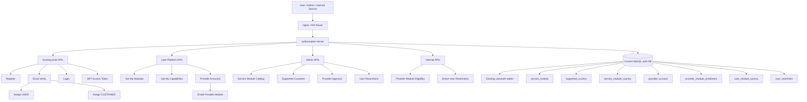
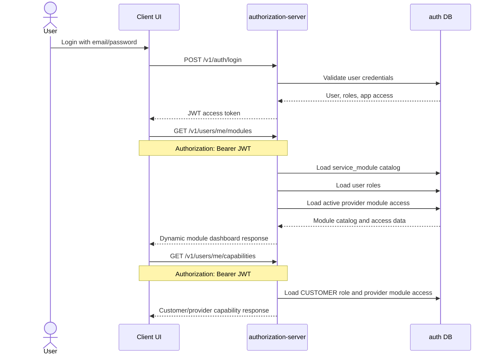
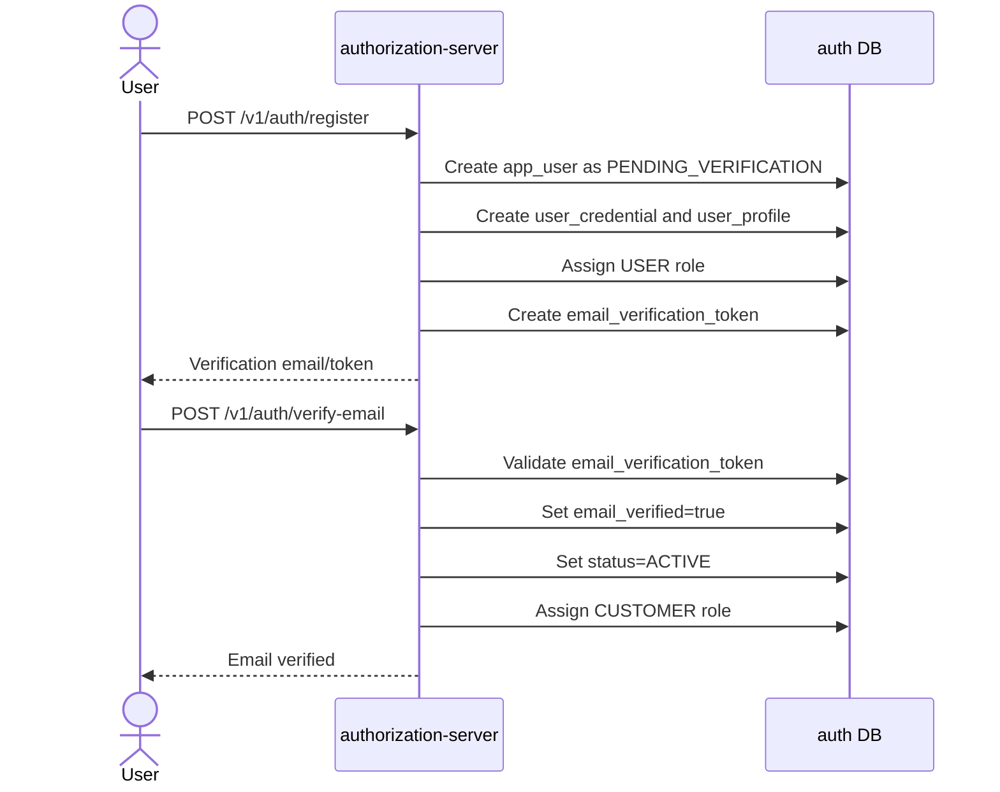
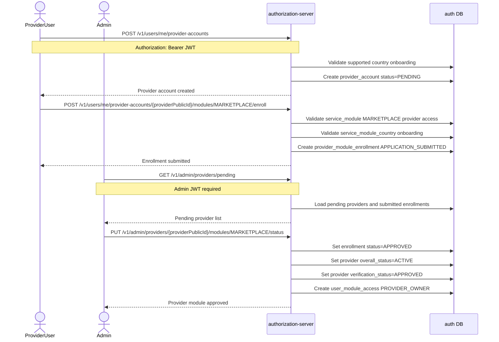
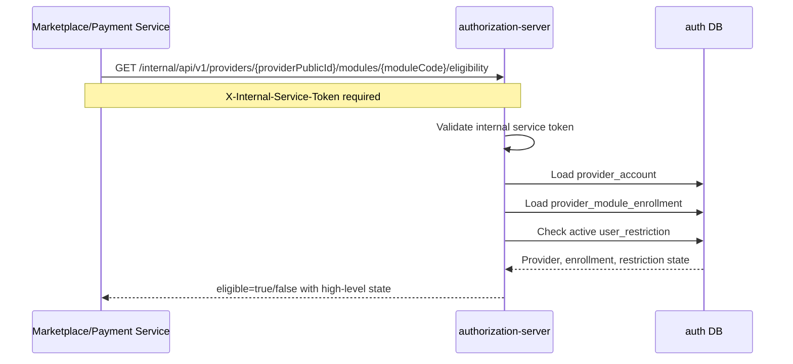
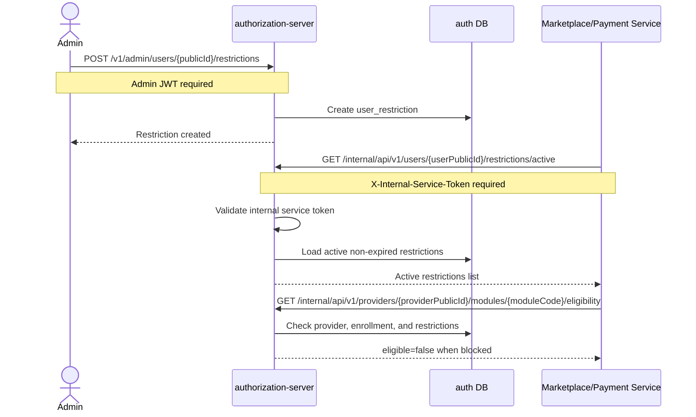
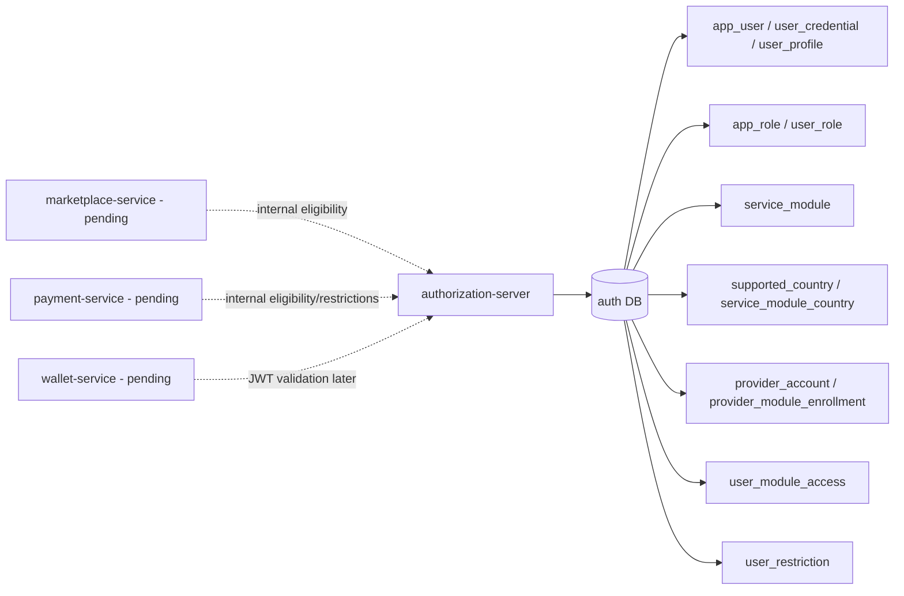

# V3 Authorization Flow Diagrams

These diagrams describe the V3.1 implementation currently completed in `authorization-server`.

Scope covered:

- Existing login and JWT creation
- User module dashboard authorization
- Verified user `CUSTOMER` role assignment
- Provider account enrollment and admin approval
- Internal provider eligibility checks
- User restrictions

Pending outside this document:

- Spring Authorization Server OAuth2/OIDC migration
- Marketplace service
- Payment service
- Wallet service
- Flutter application
- Platform web BFF

## Authorization Server Flow

## User Login And Module Access

## Email Verification Role Assignment

## Provider Enrollment And Admin Approval

## Internal Provider Eligibility Check

Eligibility returns `true` only when:

- Provider account is `ACTIVE`
- Module enrollment is `APPROVED`
- Selling is enabled
- No active provider/module/account blocking restriction exists

## User Restriction Flow

## V3.1 Data Ownership

