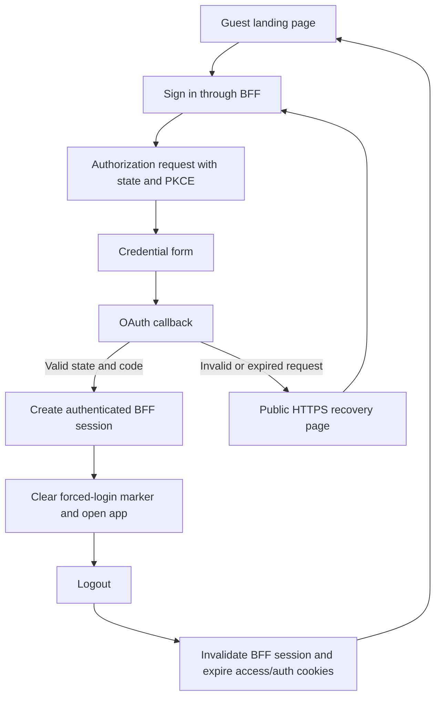

# Login redirect and session repair — 2026-10-26

The reported `https://vinodbalakumar.com:8080/login?error` address exposed an internal proxy port after an OAuth failure. The supplied account was able to authenticate; a password reset was not necessary. Start sign-in at https://vinodbalakumar.com/app/.

## Changes deployed

- Nginx forwards the public HTTPS scheme, port 443 and host without an internal port. BFF failures redirect to the configured public authorization URL, independently of incoming host headers.
- An expired, cancelled or invalid OAuth callback shows a recovery message and a link that starts a fresh OAuth request. It does not offer a credential form backed by a stale authorization request.
- Successful login expires the forced-login marker. Logout invalidates the BFF session and expires the access-token cookie and the authorization-server session cookie at its configured path. A subsequent sign-in requires credentials again.
- WebKit can send `Origin: null` on the OAuth callback navigation following the credential POST. Nginx omits Origin only for the exact GET callback route. OAuth state/PKCE validation remains in place; opaque origins remain rejected by API CORS.
- Failure logs contain allowlisted error codes, exception types and correlation IDs, without passwords, authorization codes or tokens.

## Verification and limits

Authorization-server clean Maven verification passed 35 tests. BFF clean verification passed 27 tests with one optional test skipped. Regression coverage includes canonical failure redirects, recovery messaging, successful-login marker cleanup and logout cookie cleanup. Both verified application images were deployed; authorization, BFF and its AI/network companions are healthy. Nginx configuration validation passed before reload.

The opt-in Playwright helper checks real credentials through the public HTTPS site, expected-account identity, protected profile API access, reload persistence, browser-origin logout, fresh credential entry after logout, expired-request recovery, marker cleanup, invalid-state rejection and API rejection of opaque origins. Browser runs use Chromium at 1440 pixels, Firefox at 390 pixels and WebKit at 320 pixels. These are browser-engine viewport checks, not physical-device certification.

The final Chromium 1440, Firefox 390 and WebKit 320 runs passed every functional assertion and recorded zero page errors. Console and failed-request diagnostics remain in the reports. Earlier WebKit runs intermittently emitted access-control messages during repeated forced navigation, despite successful authentication checks and no recorded HTTP error responses in the diagnostic run. This release does not claim that those intermittent warnings are resolved or that complete visual/profile-screen validation passed. The helper's pass criterion is the explicit authentication assertions; it preserves console diagnostics rather than treating them as a separate zero-error gate.

## Operations

`scripts/sharity/verify-authenticated-login.cjs` reads `LOGIN_TEST_EMAIL` and `LOGIN_TEST_PASSWORD` from the operator environment. Never commit credentials or token bodies. Set `SHARITY_LOGIN_BROWSER` and `SHARITY_LOGIN_WIDTH` to choose a browser/viewport; the helper uses the workspace storefront Playwright installation. TLS validation remains enabled. Reports are written to ignored workspace `outputs/authenticated-login-<browser>-<width>.json`.

`scripts/sharity/deploy-login-repair.ps1` deploys verified auth/BFF artifacts, preserves rollback image tags, waits for health and recreates AI/diagnostic companions that share the BFF network namespace. Deployment configuration stays in this repository. Tesla remains disabled.
