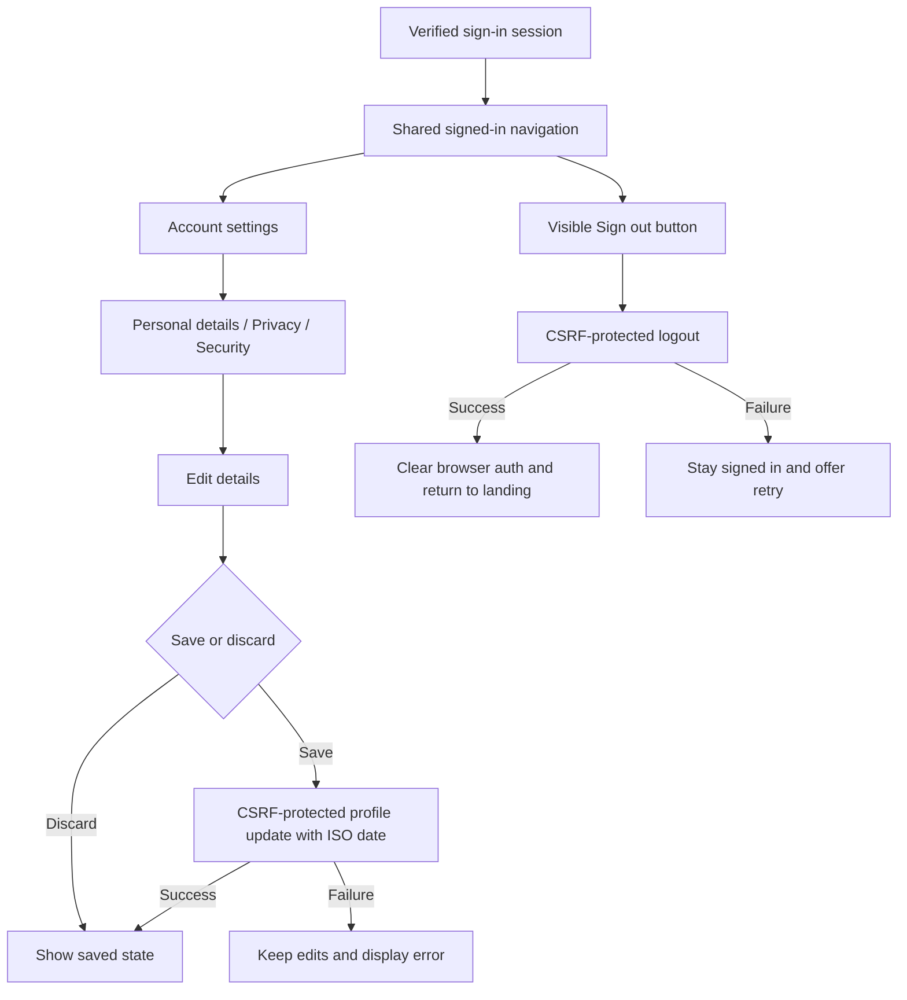

# Signed-in navigation and account experience — 2026-10-26

The previous interface hid sign-out at the bottom of the profile. Account settings mixed profile edits, technical account flags and device actions on one long screen. The updated shared header exposes a labeled, single-click **Sign out** action on signed-in marketplace screens and the AI chat, including narrow mobile layouts.

## User experience and behavior

- Account settings has a compact identity card and three sections: Personal details, Privacy, and Security & devices. Forms use the shared blue palette, system fonts, labeled controls, 16-pixel inputs and touch targets of at least 44 pixels.
- A persistent action bar enables Save changes only when the form is dirty. Discard changes restores the loaded values. Failed saves preserve edits and show an error. Date of birth is sent as an ISO date; international phone input supports up to 15 digits instead of truncating to ten.
- The legacy `LIMITED` visibility value displays as the corresponding existing visibility choice and remains unchanged unless the user selects a different preference. Privacy copy describes a stored preference; this UI change does not introduce backend authorization rules.
- The security section identifies the current browser separately from saved device sessions. It never sends a revoke request for a synthetic browser-session ID. Revoking saved sessions requires confirmation; the browser is ended using Sign out.
- A failure in optional account options/devices does not hide personal details. Photo selection supports cancellation, upload feedback and an initials fallback. Uploading a photo preserves other unsaved edits.
- Sign-out waits for a successful CSRF-protected server response before clearing local authentication. Server failures keep the signed-in state and offer a visible retry. Success clears the shared navigation state immediately, returns to the guest landing page and prevents browser-back navigation from reopening private routes.

## Verification

The `member-account.spec.ts` Playwright suite covers profile editing, payload correctness, legacy privacy values, discard behavior, failed saves, partial service failures, cancelled photo selection and header sign-out from home, marketplace, orders, wallet, profile and AI chat. Profile widths include 320, 390, 768 and 1440 pixels. Tests use synthetic account data; no real account details are changed by those tests.

The full browser baseline recorded 367 passing scenarios and four failures: three old selectors still expected the retired capitalized sign-out label, and the 320-pixel chat header allowed partial overflow. The selector and compact chat menu were corrected. All 71 final checks passed with zero failures, skips or flaky cases, including a passing recheck of each original failure. These cover the complete account suite, logout/back regression, all responsive chat widths and chat route recovery in Chromium, Firefox and WebKit. The raw baseline and final reports are retained separately; this is a full baseline plus focused final verification, not a claim that all baseline cases were rerun on the final export.

Type checking and iOS/Android Expo exports passed. ESLint reports zero errors and 52 existing warnings. Post-deployment real-account checks passed at Chromium 1440, Firefox 390 and WebKit 320 pixels: each checked Home, Marketplace, Orders, Wallet, Profile and AI chat, with visible header sign-out, no horizontal overflow, successful logout and fresh sign-in recovery. No profile edits or purchases were performed by the live checks.

Chromium and Firefox recorded zero page errors. The forced-navigation WebKit run recorded nine access-control console messages alongside cancelled requests, with no recorded HTTP error responses; functional assertions passed. These intermittent navigation diagnostics are retained as a limitation, not claimed resolved. Raw live reports stay in ignored workspace outputs. Physical-device and store-distribution validation remain separate from an Expo export.

## Deployment

`scripts/sharity/deploy-member-ui.ps1` requires full baseline evidence, a resolution record for every baseline failure, passing final focused checks and the exact final tested bundle hash. It preserves the current storefront image, deploys only the storefront, waits for health and confirms that the served HTML references the tested bundle. It rolls back on rollout failure. Backend services retain the previously deployed login repair.

For an authorized live read-only screen audit, set `LOGIN_TEST_EMAIL`, `LOGIN_TEST_PASSWORD`, `SHARITY_LOGIN_SCREEN_AUDIT=1`, browser and width, then run `scripts/sharity/verify-authenticated-login.cjs`. It checks signed-in core screens and uses the visible header action to sign out. It does not save profile edits, revoke device sessions, place orders or execute payments. Keep credentials in environment variables and all reports out of Git.
