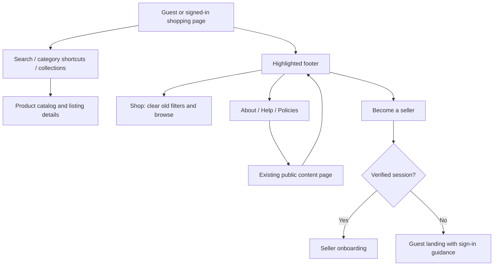

# Storefront navigation and highlighted footer — 2026-10-26

The previous footer blended into the page, hid its mobile links behind accordions and appeared only on the guest landing and public-information pages. The new shopping shell provides a full-width dark footer on scrollable shopping/account pages. Profile editing and chat keep their dedicated action layouts.

The design follows the hierarchy of the supplied shopping-site reference: clear search, recognizable category shortcuts, collection banners, a visible product grid, grouped footer links and a separate quick-action row. Sharity uses its own branding, supported categories, real catalog images and existing public content. No company addresses, related companies, payment certifications or promotional offers were invented.

## Customer navigation

- White links and muted uppercase headings separate **Shop**, **About**, **Help** and **Policies**. All groups stay expanded on mobile in a two-column layout. Help information has its own area, and gold icons highlight seller, AI and shopping actions.
- Search has a visible outline. The homepage uses a blue primary collection panel with a highlighted shopping action and desktop panels for digital goods and jewellery. The mobile banner is shorter so products remain easy to reach.
- Footer shop links clear stale search/category filters. Public-information links use the existing route manager and browser history. Opening another public page resets the reader to the top. Guest access and private-route guards remain active.
- The shared footer appears once per page, outside the constrained content column. It uses actual links with destinations, system fonts and touch targets of at least 44 pixels.

## Verification and operations

All 96 focused Playwright checks passed with no failures, skipped or flaky cases. They cover the footer at 320, 390, 768 and 1440 pixels, link destinations, browser Back, filter reset and signed-in visibility. Existing responsive-font, catalog-discovery, session-recovery and logout checks run with the new shell in Chromium, Firefox and WebKit. This is a targeted regression run, not a repeat of every older suite. Type checking and iOS/Android exports passed; ESLint reports zero errors and 52 existing warnings. All nine public-information endpoints returned HTTP 200 from the running backend before rollout. Test results and visual previews stay in ignored workspace outputs.

`scripts/sharity/deploy-verified-storefront.ps1` requires passing browser evidence, a matching bundle hash and source freshness. It preserves a rollback image, updates the storefront, waits for health and checks that served HTML references the tested export. Deployment configuration stays in this repository.

After rollout, `node scripts/sharity/verify-storefront-shell.cjs` checks the real public catalog images and footer at four sizes and follows all nine public links. `verify-authenticated-login.cjs` checks real-account navigation and header logout using credentials supplied through the operator environment. No live profile edits, purchases or payments are part of these checks. Native Expo exports verify bundling; physical-device and native OAuth certification remain separate.

The final public-site check passed with all 24 catalog images loaded at every tested width, all nine public pages opened and zero page errors. Real-account Chromium 1440 and WebKit 320 checks passed Home, Marketplace, Orders, Wallet, Profile and AI chat, followed by logout and fresh sign-in recovery. Final runs recorded no HTTP errors; Chromium recorded zero page errors, while WebKit retained three intermittent navigation console messages as a diagnostic limitation.

Initial post-rollout probes recorded transient image gateway responses and an overly short public-page deadline. Those raw reports are preserved separately from the successful final checks. The public verifier now uses the normal 30-second deadline and requires every image to exist and finish loading. The authentication verifier waits for actual sign-in/sign-out controls instead of unrelated network idleness. No underlying gateway cause is claimed from those transient observations.
