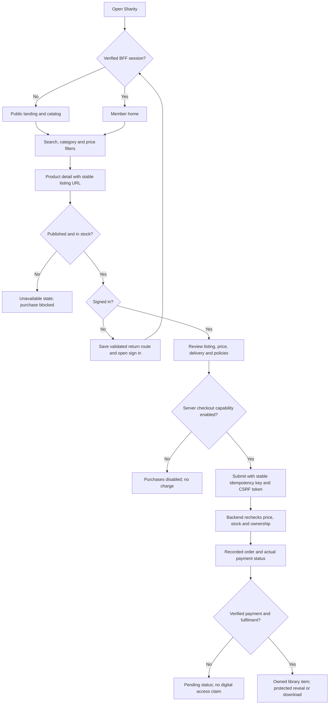
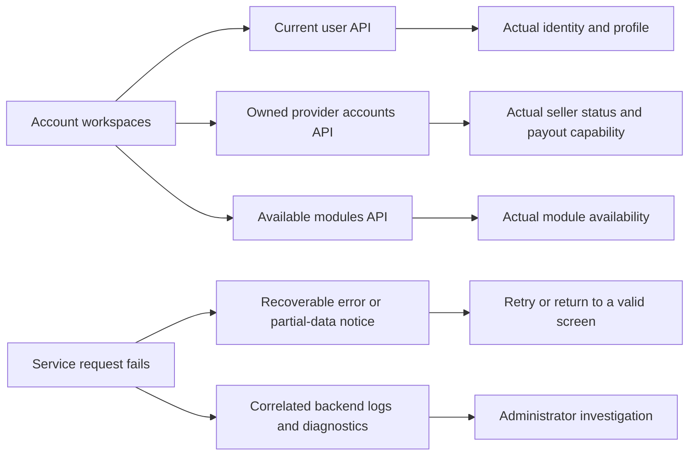

# Sharity functional flows and data boundaries

Updated 2026-10-26. Workspace: `C:/Users/HP/projects/springbootrestdemo`.

## Browse, sign in and purchase



Closing sign-in or browser Back preserves public browsing. Query parameters do not authenticate a visitor. Missing order identifiers never fall back to another order.

## Listing images

```mermaid
sequenceDiagram
    participant UI as Expo browser or native app
    participant BFF as Web BFF
    participant API as Marketplace service
    participant DB as Listing database
    participant S3 as Configured object storage
    UI->>BFF: Public catalog request
    BFF->>API: Read listings
    API-->>BFF: Listing-specific image paths
    BFF-->>UI: Catalog response
    UI->>BFF: GET listing public ID / image
    BFF->>API: Anonymous image request
    API->>DB: Verify listing visibility and current image key
    alt Public listing and allowed image key
        alt Cached image younger than five minutes
            API-->>BFF: Raster image and public cache headers
            BFF-->>UI: Image response
        else Cache miss
            API->>S3: Authenticated read of configured bucket/key
            S3-->>API: Bounded image bytes
            API-->>BFF: Image bytes; credentials stay on server
            BFF-->>UI: Image response
        end
    else Missing, unpublished or disallowed key
        API-->>BFF: Safe unavailable response
        BFF-->>UI: Image unavailable
        UI->>UI: Accessible image fallback; listing still opens
    end
```

Listing photographs have a separate rate-limit budget so a grid cannot exhaust the transactional API allowance. The existing edge request limit remains enabled.

The public R2 URL failed access checks while authenticated reads of all 24 existing listing objects succeeded. The previous UI also suppressed images whenever `demoSeed` was true. Real catalog photographs are now displayed, with a separate Demo label. Original product descriptions, prices, demo flags and storage objects are preserved.

Image delivery accepts listing IDs, not user-supplied URLs or storage keys. Only `listings/` and seller listing-image paths in the configured bucket are eligible. Unpublished listing details also return not found. Draft listing images, private profile/document paths, traversal, foreign hosts and SVG are excluded. Reads have time and size limits. In-memory caching is bounded to 64 entries and 16 MiB, with a five-minute lifetime; visibility is checked on each origin request. Browser caches may retain a previously public image for up to five minutes after unpublishing. Use a private origin/CDN invalidation policy for immediate revocation requirements.

## Accounts and operational failures



Workspace mode is a device navigation preference, not a grant of seller permissions. Backend authorization remains authoritative. Admin Commerce reports failed sections instead of silently converting failures into apparent empty results. Admin Applications and Sessions recover from failed requests with a retry; the Dashboard reports an unavailable summary.

## Implemented corrections

- Shared blue brand buttons, system typography, consistent listing cards, readable labels and compact mobile landing layout.
- Price sorting uses displayed values and separates currency groups. Order lists, details and payment summaries preserve the actual currency.
- Product details block unavailable purchases. Digital classification covers codes, downloads, software, courses and subscriptions.
- Unknown orders show not found. Pending payment cannot be presented as ready digital access.
- Removed invented seller verification/rating, addresses, tracking references, carrier estimates, payment timeline timestamps, fees, discounts and provider names from the live order adapter.
- Refund, dispute, payment authorization, order detail, payment summary and secure-access loaders recover from service errors. The active refund-review route uses a simple exact-order issue form backed by the existing report-problem endpoint, with CSRF protection, validation, duplicate-click prevention and server-confirmed submission. It does not invent evidence uploads, refund approval, response deadlines or refund identifiers.
- Seller forms resize to a single column; account controls wrap on narrow screens.
- Account workspaces now read real identity/module/provider APIs instead of fixture identities and payout claims.
- Placeholder illustrations are self-contained SVG data URIs, without third-party placeholder requests. Data URIs are parsed before comma-separated keys.
- Stable URLs exist for secure-access and payment-status screens. A payment-status route does not assert payment success.
- Admin controls share the blue palette and visible keyboard focus. Relative avatar URLs stay on the configured origin.

## Remaining product boundaries

The legacy Settings, Login Security dashboard, Rewards, Notifications, Marketplace Configuration, Pricing/Promotions and Support screens still contain prototype data. They display an explicit Feature preview notice; their simulated actions are not live account or payment changes. Actual profile updates, linked accounts and session revocation remain in Profile. These prototypes, along with legacy carrier tracking and dispute/refund-status views, need durable APIs, role/ownership tests and business acceptance before promotion to production features.

Live payments remain disabled in this local stack. No real charge, refund, shipment, carrier event, tax invoice, email delivery or installed native-device OAuth flow was certified by this work. Existing dependency advisories and historical credential rotation requirements remain separate release gates. Tesla stays disabled.

## Verification interpretation

`screen-audit.spec.ts` visits every routed feature screen at 320 and 1440 pixels with unavailable downstream APIs. It checks render failures and controls escaping the viewport; it does not certify successful integrations. Existing commerce, guest navigation, chat and responsive suites cover their documented success/failure contracts across Chromium, Firefox and WebKit. `catalog-integrity.spec.ts` covers image recovery, demo images, out-of-stock purchases, exact order identity, currency and pending-payment integrity. Live image delivery and catalog smoke checks are recorded separately after rollout.
