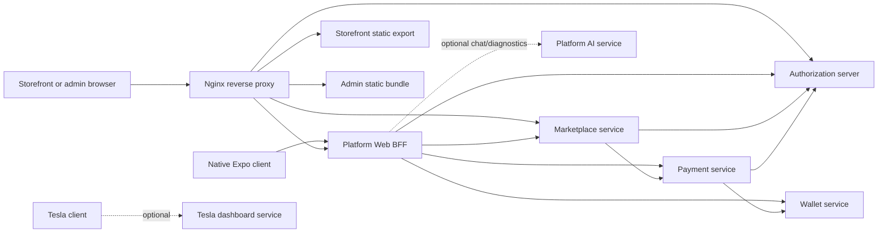

# Sharity platform architecture

## Workspace

The repository is a single Git monorepo with independently built applications.
The Maven root reactor contains six core Java services; Tesla is an optional
seventh Java module. The two JavaScript frontends keep separate npm lockfiles.
Deployment definitions, root tooling and documentation are maintained alongside
the applications.

| Component | Responsibility | Main technology | Default data/API boundary |
| --- | --- | --- | --- |
| `sharity-app-ui` | Customer storefront for web and native Expo targets | Expo, React Native, React 19, TypeScript | Uses public catalog APIs and the BFF; web assets are served under `/app/` |
| `sharity-admin-portal` | Administration screens for users, roles, audit and commerce settings | Vite, React 18, JavaScript | Same-origin authorization and marketplace APIs under `/sharity-admin/` |
| `platform-web-bff` | Browser session, OAuth callback, CSRF enforcement and API proxy | Spring Boot, Java 21 | `/bff/`; keeps browser OAuth tokens server-side |
| `authorization-server` | Accounts, sign-in, OAuth/OIDC, JWT issuance, roles and provider eligibility | Spring Boot, Java 21 | `/authorization-server/api`; owns identity data and signing key |
| `marketplace-service` | Catalog, listings, cart, order and storefront configuration | Spring Boot, Java 21 | `/marketplace-service`; owns marketplace data |
| `payment-service` | Payment lifecycle, provider adapters, refunds, disputes and payment events | Spring Boot, Java 21 | `/payment-service`; owns payment data |
| `wallet-service` | Idempotent payment-event ingestion and wallet/ledger projections | Spring Boot, Java 21 | `/wallet-service`; does not move money |
| `platform-ai-service` | AI chat/listing assistance and diagnostics features | Spring Boot, Java 21, Spring AI | Port `8086` by default; optional and configuration-dependent |
| `tesla-dashboard-services` | Authenticated Tesla Fleet integration | Spring Boot, Java 21 | `/tesla-dashboard-services/api`; optional, disabled by default in Compose |
| `deployments` | Compose, Dockerfiles, Nginx, environment profiles, scripts and workflow templates | Docker Compose, Nginx, PowerShell/shell/Node/Python | Reverse proxy and deployment boundary |
| `contracts` | Intended home for shared API specifications and compatibility fixtures | Documentation/artifacts | Currently contains a README only |

## Request and data flow

The Nginx path mappings are defined in
[`deployments/nginx/nginx.conf`](../../deployments/nginx/nginx.conf). Internal
service calls use service DNS names in Compose. JWT signing belongs to the
authorization server; resource services validate tokens with its public key.
Internal service calls also use a shared service token in the configured
deployment topology.

Commerce records belong to the owning service. Marketplace requests payment
operations from Payment Service; payment events feed Wallet Service, which
records a projection rather than initiating transfers. A physical sharing of
database infrastructure does not merge service ownership or schemas. The BFF
has its own migration history and datasource configuration; a deployment may
choose to colocate its schema with the authorization database.

AI is an optional dependency, not an authority for identity, commerce, payment,
or wallet state. The AI integration is separately configured; behavior and
availability depend on the selected deployment profile. Tesla is optional and
must not be treated as part of the core storefront.

## Public paths and service API references

The active Nginx configuration exposes the storefront at `/app/`, the admin at
`/sharity-admin/`, the BFF at `/bff/`, and service prefixes for authorization,
marketplace, payments and wallet. The chat UI is routed at `/chat`. Nginx
forwards those requests to Compose service names; direct host ports vary by
Compose file.

Each Spring service provides its own OpenAPI/Swagger routes when enabled. Use
the controller mappings and Spring configuration in that service as the
authoritative contract. There is no consolidated, versioned OpenAPI document in
`contracts/` yet; avoid assuming the component READMEs are exhaustive API
catalogs.

## Persistence

The authorization service contains MySQL and PostgreSQL migration sets.
Its `FlywayConfig` chooses a location from the connected database's JDBC
metadata, overriding profile-provided locations. Other services have their own datasource
and migration resources; inspect their application properties and deployment
profile before selecting a vendor. The AI service
uses an embedded H2 file by default and can be configured to use an external
database. No database server is provisioned by the Compose files described in
this repository; deployment examples expect configured database endpoints.

Database migrations may contain seeded or reset demo data. Review pending SQL
and take a tested backup before applying migrations to any persistent or shared
database. See [configuration and data safety](configuration.md) and the
[authorization database runbook](../../authorization-server/docs/database-operations.md).
